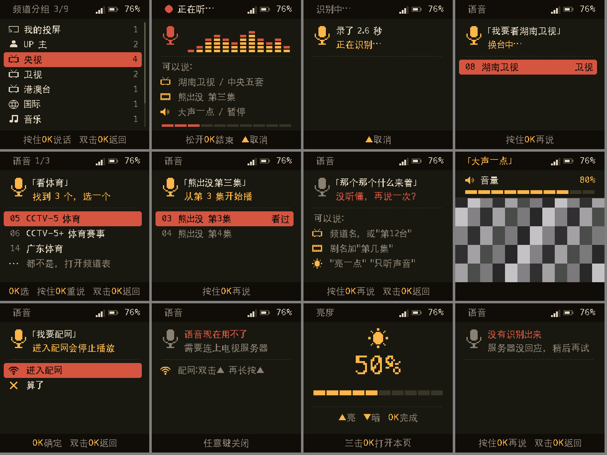
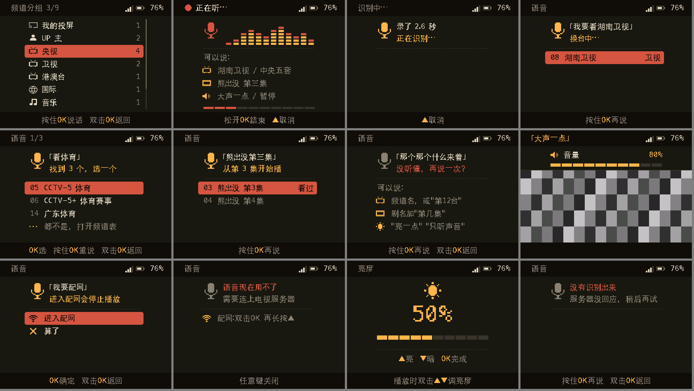

  <strong>简体中文</strong> · <a href="2026-10-12-voice-control-design.md">English</a>

# 语音控制 — 设计

状态：方案，2026-10-12。本文的东西都还没做。示意图是在电脑上用一个原型程序
（`tools/render_ui/voice_mock.c`）画的，用的是固件自己的绘制代码和字库。没有在设备上跑过任何东西；下文标「估算」的数字都没有实测。

## 目标

在小电视上按住 OK，说出想要什么，松手，设备就去做：

- 换到某个频道、UP 主或剧集（「湖南卫视」「中央五套」「熊出没第三集」）；
- 调音量、亮度，开关只听声音；暂停、继续、快进快退，下一集、上一集；
- 打开状态页，或者进入配网。

用户要求用 OK 键触发，并且频道表和语音合在**一个界面**里（「二合一」）。手机遥控和按键的现有功能照旧。

## 1. 按键手势与二合一面板

### 现在的按键（两块板，取自 `process_key()`）

| 播放时 | Passport | 星智 |
| --- | --- | --- |
| OK 单击 | 频道表 | 频道表 |
| OK 双击 | 状态页 | 开关只听声音 |
| OK 长按（1.5 秒，`CONFIG_BUTTON_LONG_PRESS_TIME_MS=1500`） | 亮度页 | 亮度页（**星智唯一的调亮度手势**） |
| ▲/▼ 单击 / 长按 / 双击 | 音量 / 组内换台 / 亮度一档 | 音量 / 组内换台 / 状态页 |
| **频道表里：** OK 单击 / OK 长按 | 确定 / 返回上一级，再按就关闭 | 同左 |

### 方案

| 播放时 | 新行为 |
| --- | --- |
| OK 单击 | 和现在一样打开频道表；底栏改成「按住OK说话 双击OK返回」（图 1）。 |
| **OK 按住 ≥ 0.45 秒** | **按住说话**：面板直接以「正在听」状态打开（图 2），松手结束这句话。 |
| OK 双击 | 两块板都不变。 |
| OK 长按（1.5 秒） | 按不到了：按住 0.45 秒时已经开始说话。Passport 没有损失，▲▼ 双击照样调亮度。**星智的亮度页改成 OK 三击打开**（图 11），也可以说「亮一点」「亮度 3」。 |

| 面板里 | 新行为 |
| --- | --- |
| ▲▼ 单击 | 移动，和现在一样。 |
| OK 单击 | 确定，和现在一样：打开分组、换台，或选中一条语音结果。 |
| **OK 按住** | **再说一次**，结果替换列表里的行。 |
| **OK 双击** | **返回上一级**，在最上一级就关闭。它取代「长按返回」；现在频道表里双击没有作用。 |
| 听或识别时 ▲ 单击 | 取消。 |

其他页面的按键都不变：状态页、宠物选择、亮度页、配网。它们仍然认 1.5 秒长按，BSP 会照常报告这个事件（见下文）。只有播放画面和面板里能说话。

**语音关闭时，按键和现在一模一样。** 语音关闭指两种情况：固件编译时 `CONFIG_AV_VOICE=n`，或者服务器的 CONFIG 没有提供语音（旧服务器，或没配语音识别的服务器）。这时 OK 按住不起作用，1.5 秒长按在两块板上都照旧打开亮度页。

### 为什么是 0.45 秒，为什么不会丢字

按键组件在松手 180 ms 后才报告单击（`CONFIG_BUTTON_SHORT_PRESS_TIME_MS`）：它要靠这段等待分辨单击和双击，所以一次单击本来就要「按下的时长 + 180 ms」。0.45 秒的门限能让有意的单击（一般不到 0.25 秒，估算）和按住分得开。

0.45 秒之前就开口说的话也收得到：**录音从 OK 按下（BUTTON_PRESS_DOWN）那一刻就开始**，而不是从判定按住才开始。单击就把这几百毫秒丢掉，按住就保留。效果和 Muse 一直开着的 120 ms 预录（`muse_voice.c`）一样，但麦克风不用一直开着。

### BSP 的按键改动

- `bsp_btn_ev_t` 新增三个事件：
  - `BSP_BTN_HOLD`：OK 按住达到 `BSP_OK_HOLD_MS`，默认 450；
  - `BSP_BTN_RELEASE`：`BUTTON_LONG_PRESS_UP`，按住后松手；
  - `BSP_BTN_TRIPLE`：`BUTTON_MULTIPLE_CLICK`，`clicks=3`。
- OK 的 `button_config_t.long_press_time` 设为 450。原来的 `BSP_BTN_LONG` 仍在 1.5 秒时报告，做法二选一：用第二个带 `press_time=1500` 的 `LONG_PRESS_START` 回调（组件支持一个键注册多个长按时长），或者由 BSP 读 `iot_button_get_pressed_time()` 自己判断。
- ▲▼ 不变，仍是 1.5 秒。
- `on_key()` 转发新事件。两块板用同一个组件：星智是 GPIO 按键，Passport 是 ADC 分压三键。
- **依赖：** 先合并 `passport-keys` 分支（`BSP_KEYS_ABOVE_VIDEO`，会话任务优先级 6）。不合并的话，C3 上复杂画面时按键要等画面平静下来才处理，按住说话会显得不灵。

### 面板状态（示意图）

- 星智，240×240：
- Passport，320×240，和其他页面一样排在中间 240 列：
  

重新生成示意图：`tools/render_ui/voice_mock.sh [--passport] out.png`。这个原型和 `render_ui.sh` 是两个独立的程序，固件现有的画面一点没改。

| # | 状态 | 屏幕上 |
| --- | --- | --- |
| 1 | 频道表待机（OK 单击） | 现在的频道表。底栏提示取代了帧率和网速那一行（这两项在状态页和日志里还看得到）。 |
| 2 | 正在听 | 顶栏显示红色 ● 和「正在听…」。麦克风图标和实时音量条来自设备自己的电平，不靠服务器。下面三行是「可以说」的例子，底部十格表示 10 秒上限。底栏是「松开OK结束 ▲取消」。 |
| 3 | 识别中 | 先显示录了多少秒，再显示「正在识别…」。 |
| 4 | 只有一个结果 | 「」里是听到的话，下面是「换台中…」，匹配到的台显示为选中的一行。立刻执行，0.8 秒后换成平常的换台横幅。 |
| 5 | 多个结果 | 最多 6 个候选，用 ▲▼ 和 OK 选。最后一行「都不是，打开频道表」回到普通频道表。 |
| 6 | 剧集加集数 | 各集的行，来自中转的分集列表（`series-episodes` 分支）。 |
| 7 | 没听懂 | 听到的话、「没听懂」和几个例子。 |
| 8 | 设备设置（音量、亮度） | 面板关闭，出现平常的音量（或亮度）框，听到的话在顶栏显示 2 秒。 |
| 9 | 配网 | 先确认，因为进入配网会停止播放。 |
| 10 | 没有会话，或服务器不支持语音 | 说明这一点，并告诉用户怎么用按键进配网。 |
| 11 | 亮度页 | 页面不变。星智用 OK 三击打开，Passport 仍是 ▲▼ 双击。 |
| 12 | 服务器出错或超时 | 「没有识别出来」，并提示再试。 |

版式：

- 面板标题区占第 36–87 行；
- y=90 是一条点线；
- 从 y=96 起最多四行 24 像素高的结果；
- 都用现有的绘制函数：`ui_draw_panel`、`ui_draw_notched_rect`、`ui_overlay_key_line`、`ui_draw_cells`；
- 唯一新增的图是一个 16×16 的麦克风 `UI_ICON_MIC`，加进 `xiaozhi_tv_ui_assets.h`；
- 文字用现有的 16 像素 GB2312 字库。SenseVoice 输出简体中文，`「」●…` 都在 GB2312 里。

## 2. 两块板的音频路径

| | Passport（ESP32-C3） | 星智（ESP32-S3） |
| --- | --- | --- |
| 麦克风 | 经 ES8311。codec 现在就以全双工打开（`ESP_CODEC_DEV_WORK_MODE_BOTH`，`no_dac_ref=true`，输入增益 30 dB），I2S0 的接收通道已经以电视的 16 kHz/16 位在跑。录音就是在现有通道上调用 `bsp_audio_read()`：**codec 不用重开，电视声音不会断一下**。 | 单独的 I2S1 接收，WS 4 / SCK 5 / DIN 6（`xingzhi_cube_154.h` 里写了，目前没用）。格式按小智固件对这块板的配置：标准模式、32 位槽、左声道、16 kHz，缩到 16 位。**还没在这块板上验证。** |
| BSP 接口 | 两个板级目录里新增 `bsp_mic_start(hz)`、`bsp_mic_read(int16_t *, n, timeout)`、`bsp_mic_stop()`。Passport 版读现有接收通道的左声道；星智版第一次 start 时建 I2S1（DMA 6×240 帧），stop 时关掉。 | （同左） |
| 处理 | 80 Hz 一阶高通（与 Muse 相同）；每 40 ms 取一次峰值给音量条；IMA ADPCM 编码。 | （同左） |
| 编码 | **IMA ADPCM，16 kHz**，块格式和电视下行音频相同（每 40 ms 640 个采样，`AV_AUDIO_BYTES`=324 字节）。上行是每 40 ms 324 字节加 24 字节包头，约 **8.7 KB/s**，是 Muse 原始 PCM（32 KB/s）的四分之一。Muse 发现经过 180 ms 往返的中转时，原始 16 kHz PCM 会把 C3 的内存撑爆（提交 `78f8f25`）。不用 8 kHz，因为 SenseVoice 是按 16 kHz 训练的。 | （同左） |
| 上传方式 | **边说边传**：每 40 ms 一块发一个包，走现有的电视连接（§6）。所以松手后约 50 ms（估算）服务器就有了整句话。 | （同左） |
| 上限 | 10 秒，到时设备自己结束这句话。Muse 是 15 秒；指令都很短。 | （同左） |

### 说话时电视怎么办

- **从按下 OK 起，设备上把电视声音静音。**
  - 两块板都没有回声消除，喇叭离麦克风只有几厘米，SenseVoice 会把节目里的话也识别进去。
  - 静音在 `audio_task` 里乘 0（星智本来就用软件调音量；Passport 也这样做，不从别的任务去写 ES8311 寄存器）。
  - 如果最后判定是单击，等单击事件到了就恢复声音：每次单击打开频道表，声音会断约 0.3 秒（估算）。如果听得出来，就改成按住判定前只压低 20 dB，不完全静音。
  - I2S DMA 里已有的约 90 ms 声音还会放完。
- **面板挡住画面时不解码。**
  - 语音面板和频道表完全盖住第 30–210 行。面板在的时候，`video_task` 从环形缓冲里取出条带就直接释放，不解压也不画。
  - 现在频道表下面的画面还在解码，这纯属浪费，而且在 C3 上正是这部分把 CPU 占满：复杂画面、每秒 140–165 kB 时，每 10 秒要做 13–16 秒的解码和刷屏（来自 `passport-keys` 那次提交的记录）。
  - 会话、连接和接收任务照常运行。接收任务只是把约 110 kB/s 的数据拷进环形缓冲（估算占 C3 的 2–4 %，按交接文档每字节 20–36 个周期算）。
- **不断开会话。** 语音就走这个连接；如果是换台指令，会话本来就会结束；其他指令执行完、面板一关，画面马上回来，不用重新连接。
- **可选，第 2 阶段：** 语音开始时让媒体服务器暂停发画面（像只听声音那样，最多 10 秒），连带省下网络。只有实测证明接收开销有影响时才做。

### 内存预算：Passport 播放时

在按下 OK 时分配，面板关闭时释放。从不说话的用户只多付出代码体积。

| 项目 | 字节 |
| --- | --- |
| 上行环形缓冲，24 个 ADPCM 块（0.96 秒，扛住 TCP 卡顿，也装得下按下到判定按住之间的预录） | 7 776 |
| 录音块（20 ms）+ PCM 块累加缓冲 | 640 + 1 280 |
| 语音任务栈 | 3 072 |
| 结果：原始 JSON（≤ 2 KB）+ 解析时的 cJSON 树（估算 3–4 KB）+ 最多 6 个候选 × 112 字节 | 峰值约 6 000，保留约 700 |
| **合计** | **听的时候约 13 KB，解析结果的瞬间峰值约 19 KB** |

播放时空闲内存约 71 KB（`tcp-delta-progress-20260930.md` 的记录）到 85 KB（用户观察）。关键是**最低**空闲内存和最大连续块，会话日志里有打印（`min_heap`、`largest`），用语音时必须读这两个数。

如果实测 C3 比这里紧，可以在暂停解码期间把视频环形缓冲的 16 KB 借给上行用。这是后备方案，不是计划，因为它让一块内存有了两个主人。

星智的片内内存不是瓶颈，但同样会记日志。

### CPU：Passport

录音、高通和 ADPCM 编码每个采样约 50 个周期 × 16 000 ≈ 每秒 0.8 M 周期，约占 160 MHz 的 0.5 %（估算）。语音任务优先级 6：

- 高于视频（5）；
- 与接收任务和会话任务同级；
- 低于音频（7）。

面板出现之前的 0.45 秒里视频还在解码，这段时间录音任务不能被饿着。I2S DMA 能缓存 90 ms，这就是余量。

## 3. 服务器

### 在哪里识别

复用 **muse-asr**（SenseVoice-Small int8，sherpa-onnx，已经作为 `muse-asr` 跑在云主机上，127.0.0.1:8102，常驻内存约 550 MB），不再起第二个模型。

媒体服务器只用 Python 标准库，而 muse-asr 的协议要用 `cryptography`（AES-GCM）。方案是在 muse-gadget-sdk 的 fork 里给 muse-asr 加一小段：

- 一个 **Unix 域套接字监听**：`/run/muse-asr/asr.sock`，权限 0660，属组 `tvserver`；
- 用明文请求（`POST /asr`，正文是 16 kHz 的 PCM16 LE，回答 `{"text": …}`）；
- 靠文件权限鉴权，不用和电视服务共享密钥；
- 原来的 HTTP+AES 通道不动，Muse 照常用。

媒体服务器先解 ADPCM（`server/adpcm.py` 加一个解码器，和设备端编码器交叉校验），再把 PCM 发过去。

**延迟目前不知道。** muse-asr 每次请求都会记上传和识别的毫秒数，但没留下过数字。先在主机上量，再承诺。目标是从松手到开始执行不超过 1.5 秒，不含换台重连。

**风险：muse-asr 的识别和合成共用一把锁。** Muse 正在合成回复（VITS，在单 vCPU 主机上是实时的 1–1.35 倍）时，语音识别要等好几秒。要在 muse-asr 里给识别单独一把锁或单独的执行器。

**实时字幕**（第 2 阶段）：SenseVoice 不是流式模型，要出中间结果，只能大约每秒把越来越长的录音重新识别一遍。对 2–3 秒的指令，只有单次识别远小于 1 秒时才负担得起，所以先测。第 1 阶段只显示实时音量条，松手后一次性显示识别出的文字。

### 意图识别：先用规则

新建一个 `server/voice/` 包，只用标准库，全是纯函数，有主机测试：

- `intent.py`：识别文字加目录，得出决定；
- `match.py`：模糊匹配；
- `numbers.py`：中文数字；
- `pinyin_table.py`：拼音数据。

**目录**每次请求现建，用媒体服务器手上已有的东西：

- CONFIG 里发给设备的频道表（id、名字、设备上显示的序号、分组）；
- 中转管理接口（本机回环、需要密钥）上一个简短的 `GET /api/voice/catalog`：剧集名、集数、正在播的剧和集、UP 主。

**规范化：**

- 全角转半角，转小写；
- 去掉标点和口头语（请、帮我、我想、我要、给我、一下、吧、啊、呢）；
- 中文数字转阿拉伯数字（三→3、十二→12、一百→100；SenseVoice 的 ITN 多数时候已经给出数字）。

**频道匹配：**

1. **精确**匹配名字或 id。
2. **别名**，由名字自动生成：
   - `CCTV-5` ↔ 中央五套 / 央视五套 / 中央5台 / CCTV5 / 五套；
   - `CCTV-5+` ↔ 五加 / 5 加；
   - 卫视台名带不带「卫视」都行（「湖南」唯一时就是湖南卫视）；
   - UP 主名、剧集名。
3. **序号**：「第12台」「12 台」「频道 12」指频道表里显示的序号。
4. **分组**：「卫视」「央视」「动画」把该组的台列为候选。
5. **模糊匹配：**
   - 分数取字符最长公共子序列比例和**不带声调的拼音**音节编辑距离比例中较大的一个，所以 ASR 写错的同音字（湖南为视 → 湖南卫视）也能对上。
   - 拼音表由 `tools/make_pinyin_table.py` 一次生成（只在开发时用 `pypinyin`），覆盖 GB2312 的 6 763 个汉字，多音字的读音全收（重 chong/zhong、长、乐、行），约 60 KB 的 Python 数据。
   - 最高分 ≥ 0.85 且领先第二名 ≥ 0.15 时**直接执行**；
   - 最高分 ≥ 0.5 时给出**候选**（最多 6 个）；
   - 否则算**没听懂**。
   - 门限用测试语料调。

**句式（举例，不是全部）：**

| 意图 | 说法 | 谁执行 |
| --- | --- | --- |
| 换台 | （换到/切到/打开/我要看/看/放）X（台/频道） | 设备（`request_switch`） |
| 相邻台 | 下一个台 / 上一个台 / 换个台 | 设备（同 ▲▼ 长按） |
| 剧集加集数 | X 第N集；第N集（正在播的剧）；X 最新一集 | 中转 `play_episode`（series-episodes 分支）；设备不在这个台上时再让设备换台 |
| 换集 | 下一集 / 上一集 / 重播这集 | 中转 `next` / `previous` / 跳到 0 |
| 暂停 / 继续 | 暂停 / 停一下 / 继续 / 接着放 | 中转（UP 主台和剧集台）；直播台回答「直播台不能暂停」 |
| 快进快退 | 快进 N 秒/分钟、快退 N、倒回去 | 中转 `seek` |
| 音量 | 大声点 / 小声点（±10，「大很多」±30）、音量 N（0–100；0–10 按 ×10 算）、静音 / 取消静音 | 设备 |
| 亮度 | 亮一点 / 暗一点 / 亮度 N | 设备 |
| 只听声音 | 只听声音 / 关掉画面 / 打开画面 | 设备（`set_audio_only`） |
| 状态 | 状态 / 信号怎么样 / 还有多少电 | 设备打开状态页 |
| 配网 | 配网 / 连 Wi-Fi / 换个网络 | 设备，先确认（图 9） |
| 宠物 | 换宠物 / 换成 X | 设备（打开宠物选择，或按名字直接换） |
| 取消 / 帮助 | 算了 / 取消；你会什么 / 帮助 | 设备关闭面板；或显示例子 |

**谁来执行：**

- **设备管的事设备做**：换台、音量、亮度、只听声音、各个页面、配网。结果里带一个 `do` 对象，键就是 `AV_SWITCH` 已经认识的那些（`channel`、`volume`、`brightness`、`audio_only`、`pet`），另加新的 `page`、`setup`。固件复用 `take_switch()`。这条路不经过中转每秒一次的事件轮询。
- **中转管的事中转做**：播哪一集、暂停、快进快退、下一集、上一集。媒体服务器调用中转管理接口时带上明确的 `device` 字段。
  - 中转的控制方法现在作用于 `self.target()`，也就是手机正在遥控的那台；语音指令必须作用于说话的那台。
  - 所以每个控制接口加一个可选的 `device`，并告诉媒体服务器自己的 id（`TV_RELAY_DEVICE=Passport`，与 `--extra-device` 一致）。

**大模型兜底**（以后，可选）：规则判定「没听懂」时，把识别文字和精简目录（只有名字，约 2–4 KB）发给大模型，要求只回 JSON；执行前先拿目录核对它的回答。代价是多一秒以上的延迟、依赖外部服务、文字要发出主机。只发文字，从不发声音。

### 回应

- **第 1 阶段只有屏幕文字和提示音。** 提示音是录音结束时一声短的上扬音，「没听懂」时一声低音，在掌管 I2S 的 `audio_task` 里现场生成，不需要素材文件。
- **第 3 阶段，语音合成（TTS）：**
  - 单 vCPU 主机上 VITS 是实时的 1–1.35 倍，一句新话合成多久，听也就多久。
  - 只朗读后面不跟换台的回答（换台有自己的横幅）。
  - 频道表变化时，把固定说法和每个频道名、剧名（「换到湖南卫视」）预先合成好放进服务器缓存，请求时就不再花时间。
  - 声音用设备已经会解的 ADPCM 块发下去。

## 4. 用语音配网：实事求是能做到什么

云端识别要联网，而配网恰恰是没网的时候。几个选项：

| 选项 | 离线可用 | 板子 | 代价 | 建议 |
| --- | --- | --- | --- | --- |
| 在线时说「配网」→ 确认 → 进入配网（等同于状态页 → 长按 ▲） | 否 | 两块 | 第 1 阶段之外没有额外代价 | **第 1 阶段。** 换新网络时有用。 |
| **配网页上的语音引导**：翻页时播放预先录好的提示（「用手机相机扫屏幕上的二维码…」「连上后打开浏览器…」「配好了，正在连接…」） | 是 | 两块 | 约 6 段 × 4 秒 × 8 KB/s ≈ 200 KB 的 ADPCM，放进固件（Passport 的 `ota_1` 还剩约 2.3 MB，factory 分区约 1.4 MB）。用现有的 VITS 声音一次合成好。 | **第 2 阶段。** 它解决真正的痛点（不知道该干什么），而且不需要麦克风。 |
| 离线命令词（ESP-SR MultiNet：「配网」「下一个台」「大声点」…） | 是 | **只有星智** | 要开 PSRAM（板上有 8 MB 八线 PSRAM，电视固件现在关着）。用 `CONFIG_SPIRAM_USE_CAPS_ALLOC`，让普通 `malloc` 和 SPI DMA 缓冲仍在片内，这正是当初关掉 PSRAM 的原因。要在 `cardid` 之后约 4.6 MB 的空闲区（0x35A000–0x800000）里加一个 `srmodels` 分区，所选中文 MultiNet 模型的大小要核对能不能放下。MultiNet 能在运行时加载命令词，所以可以把 CONFIG 里的频道名加进去（受它的命令词数量上限限制）。 | 第 4 阶段，可选，等按住说话稳定之后。 |
| 声波配网（手机网页把 Wi-Fi 名和密码用声音播出来） | 是 | 原理上两块都行 | 要一个手机网页和一个解码器（比如 ggwave）。在这两块板的麦克风上没验证过；而用手机相机扫码的配网流程已经能用。 | 现在不建议。 |

## 5. 唤醒词

- **星智：**
  - 用 ESP-SR WakeNet 可行。「你好小智」是这块板原来小智固件的唤醒词，有现成模型（请在 esp-sr 的模型列表里核对）。
  - 需要 PSRAM（同上），麦克风和前端处理一直开着，费电，并占掉一个核的一部分（待测）。
  - 难点是**电视自己的声音**：没有回声消除，节目声会导致漏唤醒和误唤醒。固件手上有播放的 PCM，可以把它当回声消除的参考信号，但要校准 I2S 的延迟。
  - **第 4 阶段，默认关闭。** 比较稳妥的第一步是只在只听声音或暂停时监听唤醒词，那时喇叭安静，或者只是小音量的音乐。
- **Passport：**
  - 只做按住说话。
  - 没有 PSRAM，播放画面时 CPU 没有余量，ESP-SR 对小芯片的支持也有限（新版 esp-sr 列出了一个给无 PSRAM 芯片用的小型 WakeNet，用之前要核实）。
  - 同一块板上的 Muse 也是按住说话。

## 6. 协议与模块

### 线路格式（FAV1；按 architecture-index §5，先改设备端结构）

| 类型 | 方向 | 内容 |
| --- | --- | --- |
| `AV_VOICE_CTL = 10` | 设备 → 服务器 | JSON。`{"op":"begin","id":n,"rate":16000,"codec":"adpcm"}`、`{"op":"end","id":n}`、`{"op":"cancel","id":n}`、`{"op":"pick","id":n,"ref":"…"}`（选中一个需要中转执行的候选） |
| `AV_VOICE = 11` | 设备 → 服务器 | 一个 324 字节的 ADPCM 块（与下行音频格式相同）；`pts` = 开始后的毫秒数；每句话最多 250 块 |
| `AV_VOICE_RESULT = 12` | 服务器 → 设备 | JSON，≤ 2 KB。`{"id":n,"state":"final"|"partial"|"error","heard":"…","reply":"…","do":{…}}` 或 `"choices":[{"label":"CCTV-5 体育","lead":"05","do":{"channel":"ch5"}}, …最多 6 个]`；候选也可以用 `"ref"` 代替 `do` |

- **能力声明：**
  - HELLO 加 `"voice":1`；
  - 只有媒体服务器配了识别套接字（`TV_ASR_SOCKET`）时，CONFIG 才回 `"voice":{"max_s":10}`；
  - 旧固件不会发新的包类型；
  - 连旧服务器时，按住 OK 显示图 10。
- **媒体服务器的几个循环：** `_device_left()`、`_wait_until()` 和暂停保持现在只接受 END 或 STATUS，改成统一经 `_take_upstream()` 收新的包类型。
  - 声音追加到每个会话的缓冲里，最多 10 秒；
  - 收到 `end` 后由工作线程做识别、意图和需要的中转调用，发送循环不会被卡住；
  - 结果放进队列，由发送循环像 SWITCH 一样发出去。
- **设备端：**
  - 接收任务掌管连接，在包与包之间把语音环形缓冲里的 `AV_VOICE*` 发出去，和现在发 STATUS 一样；语音任务从不碰连接。
  - 收到的结果加锁拷贝并置标志，由会话任务在 `pump_keys()` 里执行，和手机遥控换台一样。
- **像 Muse 那样另开一条 HTTPS 连接：电视不采用。**
  - C3 播放画面时只剩约 70 KB 内存，第二个连接加上 AES（或者 TLS：mbedTLS 要几十 KB 内存）负担太重；
  - 固件里还要再放一把密钥；
  - 设备得自己执行意图，却拿不到剧集数据；
  - 电视连接已经有配对口令鉴权，其他控制也全走它。

### 固件模块

| 模块 | 新增或改动 |
| --- | --- |
| `components/bsp/src/{passport,xingzhi_cube_154}/bsp_mic.c`、`include/bsp_mic.h` | 新增：start/read/stop；星智的麦克风引脚写进它的板级头文件 |
| `bsp_button.c`（两块板）、`bsp_button.h` | HOLD / RELEASE / TRIPLE；OK 键单独设长按时长 |
| `main/av_voice.c/.h` | 新增：语音任务（录音、高通、电平、ADPCM、环形缓冲），按下时分配，用完释放 |
| `main/av_voice_policy.c/.h` | 新增，纯逻辑，有主机测试：空闲 → 待定（按下）→ 听（按住）→ 发送 → 等结果 → 结果/选择 → 空闲；单击就丢弃；10 秒上限；8 秒等结果超时；取消；每个状态下每个键做什么 |
| `main/av_adpcm.c/.h` | 加编码器；主机测试做往返，并与 `server/adpcm.py` 交叉校验 |
| `main/av_protocol.h` / `server/protocol.py` | 三个包类型和上限；现有的常量交叉校验测试会覆盖到 |
| `main/ui_menu.c/.h` | `UI_VIEW_MENU` 里的语音子状态（标题区、候选、超时）；双击 = 返回 |
| `main/ui_overlay.c/.h`、`ui_draw.c`、`xiaozhi_tv_ui_assets.h` | 语音标题区和结果行、`UI_ICON_MIC`；底栏提示 |
| `main/av_player.c` | 按键分派、`audio_task` 的静音标志、面板遮住时 `video_task` 跳过解码、接收任务收发语音包、`CONFIG_AV_VOICE` |
| `main/Kconfig.projbuild` | `AV_VOICE`（两块板验证后默认开）、`AV_VOICE_HOLD_MS` |

### 服务器模块

| 模块 | 新增或改动 |
| --- | --- |
| `server/voice/{intent,match,numbers,pinyin_table,session,asr}.py` | 新增（见 §3） |
| `tools/make_pinyin_table.py` | 新增，只在开发时用 |
| `server/adpcm.py` | 加解码器 |
| `server/tv_server.py` | 上行包类型、工作线程、CONFIG 的 `voice`、`TV_ASR_SOCKET`、`TV_RELAY_DEVICE` |
| `server/relay/web.py` | 控制接口加可选的 `device`；`GET /api/voice/catalog` |
| muse-gadget-sdk `tools/muse_asr/server.py` | Unix 套接字监听；识别不再排在合成后面 |
| `packaging/systemd/*` | 套接字目录和属组；muse-asr 的 `MemoryMax` 不变 |

**隐私：** 不保存声音。日志只记意图类型和耗时；只有设了 `TV_VOICE_LOG_TEXT=1` 才记识别出的文字。

## 7. 测试

- **主机 C 测试（`tools/validate.sh --static`）：**
  - 语音状态机：每个状态下的每个键、门限附近单击与按住的区分、取消、超时、取消后才到的结果；
  - ADPCM 编码器（往返，以及对固定输入与 Python 编码器逐字节相同）；
  - `ui_menu` 的语音状态；
  - 检查接替 `voice_mock` 的正式画面能画出来。
- **主机 Python 测试：**
  - `tests/test_voice_intent.py`：约 200 句话到预期结果的对照表，基于固定的频道表和剧集目录。覆盖同音字、数字（中央五套、第十二集、5 加）、别名、有歧义、没听懂。
  - `tests/test_voice_session.py`：包序列、10 秒上限、取消、识别超时和出错（识别用桩代替）。
  - 协议常量交叉校验。
- **语料：**
  - 一个只在开发时用的服务器选项把每句话存成 WAV（默认关闭）；
  - 每块板录约 50 条真实指令；
  - `tools/voice_eval.py` 离线回放，过一遍识别和意图，得出每块板麦克风的文字准确率和意图准确率。
- **设备测试**（每块板都要做；按 AGENTS.md，公开版要从擦除过的设备开始）：
  - **时序：** 按住到出现「正在听」小于 100 ms；第一个字不丢；按住时电视静音；单击仍能打开频道表，声音只断一小下。
  - **其他手势：** 双击、三击照常；星智三击调亮度。
  - **Passport 性能：** 复杂画面下说话期间和之后的帧率、按键延迟。
  - **内存：** 用语音时的最低空闲内存和最大块，记日志；连续 20 次指令后内存稳定。
  - **其他状态：** 只听声音、暂停和等待画面下用语音；旧服务器；旧固件连新服务器。
  - **Muse 双系统：** 状态页双击 OK 仍能回到 Muse。

## 8. 分阶段计划

工作量是代理实现的工作日，中间穿插用户上机验证。

| 阶段 | 内容 | 工作量 |
| --- | --- | --- |
| 0 | 合并 `passport-keys`；在主机上测 SenseVoice 延迟；两块板各录一段原始声音把麦克风调通（星智的格式还没验证） | 1–2 |
| **1** | 两块板按住说话、二合一面板、连接内协议、muse-asr Unix 套接字、规则意图（换台、分组、序号、剧集加集数、音量、亮度、只听声音、暂停继续、快进快退、下一集上一集、状态、配网）、屏幕回应和提示音、星智三击调亮度、测试 | 14–17 |
| 2 | 实时字幕（如果识别够快）、配网语音引导（预录）、说话时服务器暂停发画面（如果实测有用）、用语料调门限 | 5–7 |
| 3 | 带名字缓存的语音回答；可选的大模型兜底 | 4–6 |
| 4 | 星智：开 PSRAM，ESP-SR WakeNet（先只在只听声音或暂停时）和 MultiNet 离线命令词（含「配网」） | 8–12，风险最大 |

## 9. 风险

- **麦克风：**
  - 星智的 I2S1 麦克风这个固件从没用过，格式和增益都没验证。
  - Passport 的麦克风在 Muse 里以 30 dB 增益用过，但没在电视刚静音的房间里用过。
- **识别：**
  - 频道名对语音识别不友好：CCTV-N 里的数字、英文缩写、同音字。
  - 靠拼音匹配和别名补救，用语料衡量效果。
- **C3：**
  - 解析结果时如果 CONFIG 也在内存里，可能出现内存碎片：结果控制在 2 KB 以内。
  - 优先级设错会让按键延迟变差。
- **主机：**
  - 一个 vCPU 要同时跑两个媒体服务器的 ffmpeg、中转和 SenseVoice，一次识别可能让推流抖一下。
  - muse-asr 只有一把锁（§3）。
- **手势：** 面板里的返回从长按改成双击，星智的亮度从长按改成三击，用户要重新习惯；底栏提示会写明。
- **隐私：** 语音发到用户自己的主机，在电视连接上是明文，和这条连接上的其他内容一样（配对口令能挡住扫描，但不是加密）。

## 10. 需要用户决定的问题

1. **星智调亮度：** OK 三击加语音指令合适吗？另一个选择是在状态页加一行「亮度」。
2. **面板里双击 OK 返回可以接受吗？** 另一个选择是长按 ▲ 返回。
3. **按住门限：** 0.45 秒合适吗？
4. **只有一个结果时：** 立刻执行（方案如此），还是总先显示 0.8 秒、可以取消？
5. **按下时的电视声音：** 每次单击打开频道表声音断约 0.3 秒，能接受吗？还是改成压低音量而不静音？
6. **回应方式：** 第 1 阶段只有屏幕文字和提示音够不够？还是想早点有语音回答？
7. **第 4 阶段**（星智开 PSRAM、唤醒词、离线命令词）要不要做？它会改变星智的内存配置。
8. **日志：** 调门限期间，可以在主机上记录识别出的文字吗？
